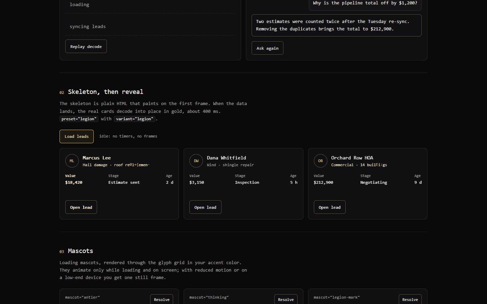
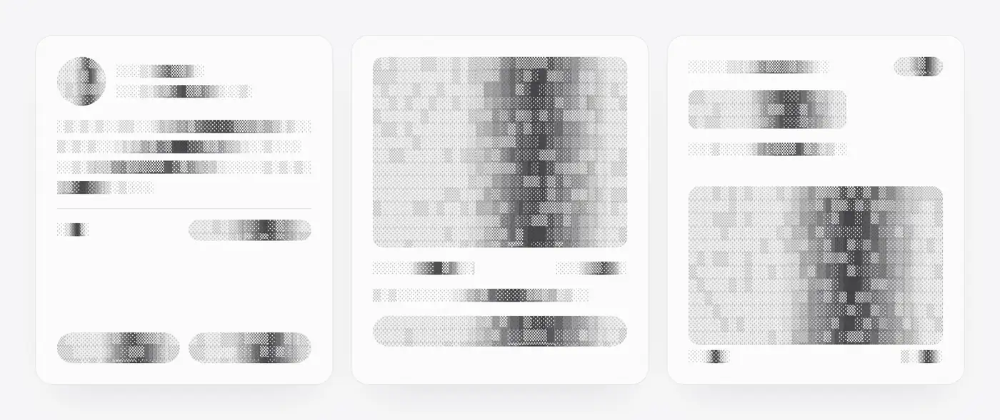
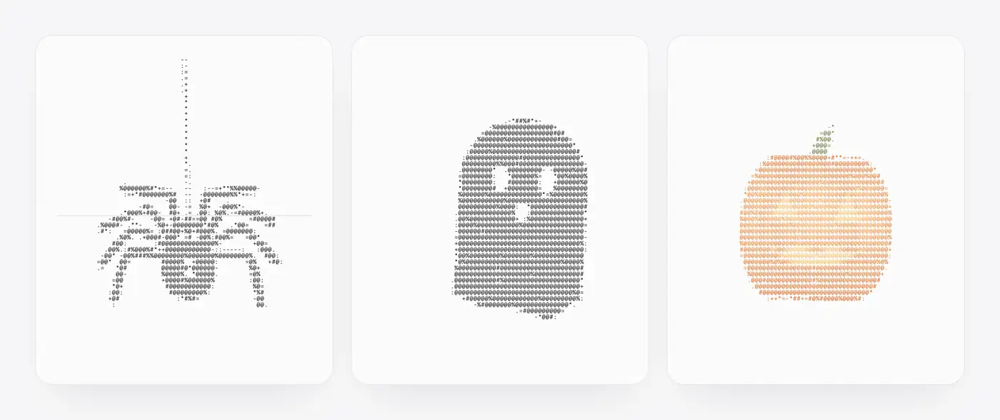

# ascii-reveal-legion

> The Legion design system's loading and reveal engine. A fork of [ascii-reveal](https://github.com/quanhoangindex/ascii-reveal) by Quan Hoang (MIT): gold-on-black terminal skeletons, loaders and reveals, with performance guardrails built in. Jump to [Legion design](#legion-design).

<a href="https://quanhoangindex.github.io/ascii-reveal/">
  <picture>
    <source media="(prefers-color-scheme: dark)" srcset="assets/readme/ascii-reveal-demo-dark.webp">
    
  </picture>
</a>

<sub>Recorded from the real component: <code>&lt;AsciiSkeleton&gt;</code> while loading, then <code>&lt;AsciiReveal&gt;</code> decodes the data in. <b><a href="https://quanhoangindex.github.io/ascii-reveal/">Try the upstream live demo →</a></b></sub>

```tsx
<AsciiReveal loading={!data}>
  {data ? <Profile data={data} /> : <AsciiSkeleton lines={3} />}
</AsciiReveal>
```

A loading effect for React. Text, images and whole cards decode into place through a character grid, in one wave across the page.

- **No layout shift.** Your content stays in the DOM in its real position. The scramble is drawn on a layer above it.
- **Works on anything.** Wrap a subtree and every text node, ``, `<canvas>` and `<video>` inside it takes part.
- **Real loading states.** Set `loading` and the content scrambles out, a glyph shimmer runs where the data will land, then the new data decodes in.
- **Accessible.** Screen readers read the real text the whole time. `prefers-reduced-motion` turns the reveal into a short fade.
- **Skeleton-fast.** `<AsciiSkeleton>` is plain HTML and CSS: it paints on the first frame, renders on the server and needs no JavaScript. Data becomes readable about 400 ms after it arrives.
- **Light.** One canvas per reveal, repainted at ~30 fps, one animation loop shared by every instance. Slow devices get a short fade instead. About 15 KB gzipped with all mascots and the skeleton, no dependencies.

## Legion design

This fork is the loading and reveal engine of the Legion design system: gold on black, terminal-flavoured, for the Legion CRM and Moose Code (Next.js 16, React 19). Everything in the upstream README below still works unchanged; this section is what the fork adds.

<picture>
  
</picture>

<sub>Skeleton, then reveal, on the demo's Legion page (`npm run demo`, then open `legion.html`). Mobile: <a href="assets/readme/legion-skeleton-390.png">skeletons at 390 px</a>, <a href="assets/readme/legion-mascots-1440.png">the three mascots</a>.</sub>

### Setup

```tsx
// app/layout.tsx: once. Dark only. Sets every variable the engine reads.
import 'ascii-reveal-legion/legion.css';
```

```tsx
// any client component ('use client' is already in the package)
import { AsciiReveal, AsciiSkeleton, AsciiLoader } from 'ascii-reveal-legion';

<AsciiReveal preset="legion" loading={!leads}>
  {leads ? <LeadTable rows={leads} /> : <AsciiSkeleton variant="legion" lines={4} />}
</AsciiReveal>

{isLoading && <AsciiLoader />}                          {/* ▌ loading   */}
{isThinking && <AsciiLoader variant="thinking" />}      {/* ▌ thinking ... (Moose Code) */}
<AsciiReveal loading={isLoading} mascot="antler">…</AsciiReveal>
```

Server components can import `asciiSkeletonHTML` and `asciiLoaderHTML` from `ascii-reveal-legion/core`, which has no React in it and no `'use client'`.

### The rules this engine keeps

- **Nothing animates at idle.** When nothing is loading there are no timers and no `requestAnimationFrame` callbacks scheduled, anywhere. The test suite counts them (see below).
- **Motion is tied to a live loading state.** Skeletons shimmer while they are on screen, loaders decode once when they appear, mascots play while `loading` is true. Nothing loops decoratively.
- **Reduced motion shows the end state.** Skeletons and loaders are still, mascots are one still frame, a reveal shows the content at once.
- **Dark only, tokens not hex.** Colors come from `--ascii-*` variables, defined in `legion.css`.
- **Cheap on low-end laptops.** See the guardrails below.

### Presets, variants, mascots, loader

| What | Name | Look |
| --- | --- | --- |
| Reveal preset | `legion` | A block cursor (`▌`) leads each character, which condenses through `. : - = + * # ▒ █`, flickers through hex and punctuation, then locks to its real value. Glyphs, surface dots and image glyphs use `--ascii-accent` (gold). Tick 52 ms. |
| Skeleton variant | `legion` | Dither shading with scan dots, in the muted color. A band of dense blocks and operators sweeps through it in `--ascii-accent`. Change the variable and the band follows. |
| Mascot | `antler` | The brand glyph redrawn from its path data. Grows up from its base once, then holds still while a pale band drifts up it. Color follows `--ascii-mascot`. |
| Mascot | `thinking` | Three dots with one slow swell travelling through them (about 4 s a pass). Small and calm, for "the model is thinking". |
| Mascot | `legion-mark` | The brand SVG itself, scanned in once from the top. `legionMark(svgMarkup)` makes the same thing from any SVG markup. |
| Component | `AsciiLoader` | One line that replaces a spinner: `▌ loading`. The label decodes once (about 0.4 s); after that no JavaScript runs. `variant="thinking"` adds three dots that swell in turn. A polite `role="status"` for screen readers. |

`AsciiLoader` props: `label`, `variant` (`'cursor' | 'thinking'`), `blink`, `quality`, `as`. The cursor blink is a CSS opacity animation, so the browser runs it off the main thread, and it is off with reduced motion. Without React: `el.innerHTML = asciiLoaderHTML({ label: 'syncing' })`, then `animateLoaders(el)`. A server-rendered loader blinks (CSS only) until the page hydrates; once JavaScript runs, a low-end device or reduced motion makes it still.

### Performance guardrails

```ts
import { setAsciiQuality, setAsciiLimits } from 'ascii-reveal-legion';

setAsciiQuality('auto');   // 'auto' (default) | 'full' | 'lite' | 'off'
setAsciiLimits({ maxAnimatedSkeletons: 6, maxAnimatedArea: 800_000 });   // the defaults
```

| Quality | Skeletons | Loaders | Mascots | Reveal |
| --- | --- | --- | --- | --- |
| `full` | shimmer (within the caps) | decode, then blink | animate | decode |
| `lite` | still pattern | still | one still frame | one 220 ms fade |
| `off` | still pattern | still | one still frame | content appears at once |
| `auto` | `full`, but `lite` on low-end devices (4 or fewer logical cores, or 4 GB or less of memory), and `off` with `prefers-reduced-motion` | | | |

- `prefers-reduced-motion` always wins, even over `full`. A 2-core laptop that you set to `full` does animate; that is the opt-in.
- **Hard caps.** At most 6 skeletons shimmer at once (and at most 800 000 px² between them). The rest keep their still pattern, which paints just as fast. Only on-screen skeletons hold a slot, earlier ones first, so scrolling hands slots on. The first skeleton always fits the area cap, so one big hero skeleton is not stuck still. A skeleton's shimmer canvas only exists while it holds a slot.
- **Off-screen means off.** Skeletons, loading shimmers and mascots stop drawing when they leave the viewport, and the frame loop goes to sleep instead of idling at 60 Hz. It wakes from an `IntersectionObserver` or `ResizeObserver` callback.
- **Hidden tabs** cancel the frame loop.
- **Without React**, keep the function that `animateSkeletons` / `animateLoaders` returns and call it before you remove the markup; React components do this for you. Do not call `animateSkeletons` on a subtree that contains React-rendered skeletons.
- **Per component.** `quality` on `AsciiReveal`, `AsciiSkeleton` and `AsciiLoader` overrides the global setting for that one component (reduced motion still wins).
- **Live.** `setAsciiQuality` and `setAsciiLimits` take effect on skeletons, loaders and playing mascots that are already on the page, and the reduced-motion preference is watched too.
- The setting lives on `globalThis` under a `Symbol.for` key, so `ascii-reveal-legion`, `ascii-reveal-legion/core` and the CommonJS build share one value.
- Note for the owner's own machine: `auto` treats a 4-core laptop as low-end, so you will see still skeletons by default. Call `setAsciiQuality('full')` to see everything.

#### The idle-CPU guarantee, and how it is tested

When nothing is loading, nothing is scheduled. `test/guardrails.mjs`, `test/legion.mjs` and `test/hydrate.mjs` wrap `requestAnimationFrame`, `setTimeout` and `setInterval` in a real Chromium and assert that the count of pending callbacks is zero: on a fresh page, after a reveal finishes, right after `destroy()` or React unmount, with every skeleton and mascot off screen, in a hidden tab, with `lite` / `off` / reduced motion / a 2-core device, and after a loader's decode. The only continuous activity in the whole library is the CSS cursor blink on an `AsciiLoader`, and the skeleton and mascot loops while something is loading on screen.

### Theming

`legion.css` defines these on `:root` (and on `.ascii-legion` if you want them scoped):

| Variable | Value | Used for |
| --- | --- | --- |
| `--ascii-accent` | `#e8c16a` | cursor, lit glyphs, the skeleton band, the loader cursor |
| `--ascii-glyph` | `#a8a6a0` | scramble glyphs for presets that do not use the accent |
| `--ascii-skeleton` | `#a8a6a0` | the still glyph pattern of a skeleton |
| `--ascii-flash` | `#f6e6b8` | brief color as each character lands |
| `--ascii-surface` | `#0a0a0b` | what transparent images sit on |
| `--ascii-mascot` | `#e8c16a` | antler, thinking dots, other line-art mascots |
| `--ascii-font` | your `--legion-font-mono`, `--font-mono` or `--font-geist-mono`, else the system mono stack | everything |

It also defines `--legion-bg: #0a0a0b`, `--legion-text: #f5f4f0`, `--legion-muted: #a8a6a0`, `--legion-gold: #e8c16a` and `--legion-gold-pale: #f6e6b8`, and a `.ascii-legion` class that sets the surface and text colors and `color-scheme: dark`.

### React 19 and Next.js 16

- Peer range `^17 || ^18 || ^19`. The repo is developed and typechecked on React 19; the SSR and hydration tests also run on React 18.
- `dist/index.js` and `dist/index.cjs` start with `"use client"`. The framework-free `ascii-reveal-legion/core` does not.
- No `React.FC`, `defaultProps`, `propTypes`, `findDOMNode` or legacy render API (a test scans the source for them).
- Server markup is deterministic: no `Math.random`, no ids, no dates. A test renders every skeleton variant and the loader with `react-dom/server` twice and compares the HTML; another server-renders a full document and hydrates it in Chromium under `StrictMode` and fails on any hydration warning or recoverable error. Server-rendered content is never hidden on hydration.
- React 19 hoists the skeleton and loader `<style>` once per page. React 18 repeats it per instance; add `SKELETON_CSS` and `LOADER_CSS` from `ascii-reveal-legion/core` once and pass `css: false` to the HTML helpers if that matters.

---

## Install

From npm (once published):

```bash
npm i ascii-reveal-legion
```

Straight from GitHub (no npm publish needed):

```bash
npm i github:MShanteer/ascii-reveal-legion-design-
```

React 17, 18 or 19 is a peer dependency. The built files in `dist/` are committed, so the GitHub install works without a build step.

## Quick start

```tsx
import { AsciiReveal } from 'ascii-reveal-legion';

export function Page() {
  return (
    <AsciiReveal preset="decode">
      <article className="card" data-ascii="surface">
        
        <h2>Hello world</h2>
        <button data-ascii="fade">Read more</button>
      </article>
    </AsciiReveal>
  );
}
```

The content reveals when the component mounts.

### Loading states

```tsx
const { data, isLoading } = useQuery(...);

<AsciiReveal loading={isLoading} selector="[data-value]" revealOnMount={false}>
  <dd data-value>{data?.latency ?? '—'}</dd>
</AsciiReveal>
```

When `loading` turns `true`, the matching content scrambles out and a shimmer runs in its place. When it turns `false`, the new content decodes in.

### Skeletons

Skeletons exist to paint instantly while data loads. `AsciiSkeleton` does exactly that, in ASCII. There are two ways to use it ([live demo](https://quanhoangindex.github.io/ascii-reveal/#skeleton)):

**1. Skeleton only.** A drop-in replacement for a gray skeleton. Content appears as normal when it arrives.

<picture>
  <source media="(prefers-color-scheme: dark)" srcset="assets/readme/skonly-dark.webp">
  
</picture>

```tsx
import { AsciiSkeleton } from 'ascii-reveal-legion';

{data ? <Profile data={data} /> : <AsciiSkeleton lines={3} />}
```

**2. Skeleton + reveal.** The skeleton paints first; when the data arrives, the real content decodes in (about 400 ms).

<picture>
  <source media="(prefers-color-scheme: dark)" srcset="assets/readme/skreveal-dark.webp">
  
</picture>

```tsx
import { AsciiReveal, AsciiSkeleton } from 'ascii-reveal-legion';

<AsciiReveal loading={!data}>
  {data ? <Profile data={data} /> : <AsciiSkeleton lines={3} />}
</AsciiReveal>
```

The reveal never animates the skeleton itself. It leaves it alone while loading, and decodes the content that replaces it.

- It's static markup plus a CSS flicker, so it shows up in server-rendered HTML before any JavaScript runs, and reserves the space your content will take.
- Patterns are deterministic, so server and client output match (no hydration warnings).
- `lines` and `widths` shape a paragraph; `rows`, `width`, `height` and `circle` make a block for an image or avatar.
- A band of denser glyphs sweeps across a faint base pattern, like a classic shimmer. The pattern is plain HTML/CSS; the sweep is drawn on a small canvas once the component mounts. With reduced motion, the sweep stops.

Pick a style with `variant`:

| `variant` | Look |
| --- | --- |
| `dither` (default) | Shaded blocks `░▒▓█` that read as soft bars, with a darker dither band scanning across. |
| `scan` | Faint dots with a band of dense, scrambling glyphs. Matches the `decode` preset. |
| `braille` | Fine braille dot texture; the band fills the dots in. |
| `terminal` | Faint 0s and 1s, lit up in `--ascii-accent` as the band passes. |
| `legion` | Dither shading with scan dots; the band is dense blocks and operators in `--ascii-accent`. |

```tsx
<AsciiSkeleton variant="braille" lines={3} />
<AsciiSkeleton variant="dither" rows={6} width={64} height={64} circle />
<AsciiSkeleton animate={false} lines={2} />   {/* still pattern: cheapest, for long lists */}
```

Without React: `el.innerHTML = asciiSkeletonHTML({ lines: 3 })`, then `animateSkeletons(el)`, both from `ascii-reveal/core`.

#### How much does it cost?

A skeleton only does its job if it shows up as fast as a gray box and never delays the data, so we measured it against one. Pre-rendered pages, no JavaScript needed to paint, Chromium on a machine without a GPU (so all drawing is done in software, the worst case), median of 7–11 runs:

| 12 cards, normal CPU | Gray skeleton | AsciiSkeleton | AsciiSkeleton `animate={false}` |
| --- | --- | --- | --- |
| First paint | 48 ms | 44 ms | 36 ms |
| Style + layout at load | 2 ms | 9 ms | 5 ms |
| Browser CPU while waiting | 15% | 21% | 0% |
| HTML (gzipped) | 0.5 KB | 3.2 KB | 3 KB |

How it stays cheap:

- The markup is a still glyph pattern (plain HTML + CSS), so it paints on the first frame before any JavaScript runs.
- The shimmer is drawn on one small canvas per skeleton at ~30 fps once the component mounts. Each row's glyphs are rendered once; a frame only copies the moving band. (Our first version animated a CSS mask instead: it looked the same but used 62% CPU, because the browser repainted every row every frame.)
- Off-screen skeletons, background tabs and reduced motion don't animate at all. For long lists, `animate={false}` skips the shimmer entirely.
- `AsciiSkeleton` never delays your data: content swaps in the moment it arrives. Only the optional `AsciiReveal` decode adds time (~350–400 ms after the data lands).
- With React 19, the skeleton's CSS is sent once per page. With React 18 it's repeated inline per skeleton; add `SKELETON_CSS` to your page once and use `asciiSkeletonHTML({ css: false })` if that matters to you.
- Without React: `el.innerHTML = asciiSkeletonHTML({ lines: 3 })`, then `animateSkeletons(el)` to start the shimmer.

Run it yourself: `node scripts/skeleton-bench/build.cjs && node scripts/skeleton-bench/bench.cjs`.

### Server rendering

Content that arrives in server-rendered HTML is never hidden on hydration: it's already readable, so hiding it to animate it would make the page slower. Set `revealOnHydrate` if you want the effect anyway. Client-side navigations and `loading` transitions animate as usual.

### Loading mascots

Swap the shimmer for an animated ASCII mascot while data loads. (Legion adds `antler`, `thinking` and `legion-mark`, see above.) It dissolves as the new content decodes in.

<picture>
  <source media="(prefers-color-scheme: dark)" srcset="assets/readme/mascot-dark.webp">
  
</picture>

```tsx
<AsciiReveal loading={isLoading} mascot="spider">  {/* spider | ghost | pumpkin | bat */}
  <Stats data={data} />
</AsciiReveal>

<AsciiReveal loading={isLoading} mascot="/logo.svg">…</AsciiReveal>      {/* your own SVG */}
```

Pass an SVG URL, SVG markup, or a draw function `(ctx, w, h, t, color) => void` for full control. Set `--ascii-mascot` to change the color of the line-art mascots.

### Replay from code

```tsx
const ref = useRef<AsciiRevealHandle>(null);

<AsciiReveal ref={ref}>…</AsciiReveal>

// replay one card from where it was clicked
ref.current?.reveal({ within: cardElement, origin: { x: e.clientX, y: e.clientY } });
ref.current?.hide();
```

## Props

| Prop | Type | Default | What it does |
| --- | --- | --- | --- |
| `preset` | `'decode' \| 'dither' \| 'terminal' \| 'blueprint' \| 'legion' \| Preset` | `'decode'` | Glyph set, timing and image style. |
| `duration` | `'fast' \| 'cinematic'` | `'fast'` | `fast` makes data readable in ~400 ms. `cinematic` is the slower, showier wave for hero sections. |
| `speed` | `number` | `1` | Playback speed multiplier on top of `duration`. |
| `origin` | `'center' \| 'top-left' \| 'pointer' \| { x, y }` | `'center'` | Where the wave starts. `{ x, y }` is in viewport pixels. |
| `selector` | `string` | – | Only animate content inside elements matching this selector. |
| `revealOnMount` | `boolean` | `true` | Reveal when the component mounts. |
| `loading` | `boolean` | – | Scramble out and shimmer while `true`; decode in when it turns `false`. |
| `shimmer` | `boolean` | `true` | Show the glyph shimmer while loading. |
| `lazy` | `boolean` | `true` | Sections below the fold decode as they scroll into view instead of all at once. |
| `revealOnHydrate` | `boolean` | `false` | Also animate content that was server-rendered. |
| `fallback` | `boolean` | `true` | If frames take too long, finish the animation and use a short fade for the next 10 s. |
| `mascot` | `'spider' \| 'ghost' \| 'pumpkin' \| 'bat' \| 'antler' \| 'thinking' \| 'legion-mark' \| string \| MascotDraw` | – | Animated ASCII mascot instead of the shimmer while loading. |
| `quality` | `'auto' \| 'full' \| 'lite' \| 'off'` | `'auto'` | Performance guardrail for this component; overrides `setAsciiQuality`. See [Performance guardrails](#performance-guardrails). |
| `onRevealComplete` | `() => void` | – | Called when a reveal finishes. |
| `as` | `ElementType` | `'div'` | Element used for the wrapper. |

All other props pass through to the wrapper element.

## Marking elements

| Attribute | Effect |
| --- | --- |
| `data-ascii="surface"` | Cards and panels. A dot field and corner frame appear first, then the surface fades in. |
| `data-ascii="fade"` | Buttons, chips, badges. Fades in on the wave. |
| `data-ascii="media"` | Treat any element as media (rendered as a glyph texture). |
| `data-ascii="skip"` | Leave this subtree alone, for example a toolbar that must stay usable. |
| `data-ascii-digits` | Scramble only through digits (applied automatically to numeric text). |

## Theming

The effect reads these CSS custom properties from the wrapper:

```css
.my-app {
  --ascii-accent: #5b8cff;   /* cursor and blueprint glyphs */
  --ascii-skeleton: #888;    /* AsciiSkeleton glyph color (defaults to the text color) */
  --ascii-flash: #5b8cff;    /* optional: brief color as each character lands */
  --ascii-glyph: #888;       /* scramble glyph color (defaults to the text's own color at 50%) */
  --ascii-font: "Geist Mono", ui-monospace, monospace;
  --ascii-surface: #0b0b0d;  /* color behind transparent images, if detection is wrong */
}
```

## Without React

```ts
import { createAsciiReveal } from 'ascii-reveal-legion/core';

const reveal = createAsciiReveal(document.querySelector('#app')!, { preset: 'dither' });
reveal.reveal();
// later
await reveal.hide();
reveal.shimmer(true);
```

## Presets

- **decode**: characters condense from light glyphs to dense ones, then lock to their real value.
- **dither**: block shading; images resolve in their own colors.
- **terminal**: a cursor leads each character, binary-style scramble.
- **blueprint**: line glyphs in the accent color.
- **legion**: a block cursor leads each character; blocks and operators in the accent color. See [Legion design](#legion-design).

Make your own by passing an object with the `Preset` shape (`ramp`, `scramble`, `mode`, `color`, `cells`, `tick`).

## Performance

Measured on the demo page with Playwright and Chromium, CPU throttled 4×, on a machine with no GPU (so every frame is drawn in software, which caps even the idle page at ~19 fps). Run it yourself with `scripts/bench.cjs` (instructions at the top of the file).

| | v0.2 | v0.3 |
| --- | --- | --- |
| Frame rate during Replay (page idle rate in brackets) | 8.4 fps (12.5) | 16.6 fps (19) |
| 95th percentile frame | 372 ms | 133 ms |
| Longest main-thread task | 297 ms | 174 ms |
| Data readable after it arrives | ~920 ms | ~350 ms |

Without throttling, v0.3 Replay runs at the page's idle frame rate and the longest task drops from 68 ms to under 20 ms. Note that v0.3's demo also replays only the card grid rather than the whole page.

What changed:

- **One canvas per reveal**, sized to what's animating, instead of one per image and card. Text that has landed is drawn once to a cached layer.
- **~30 fps repaint** for glyphs (they only change every 60–90 ms anyway); opacity still updates every frame.
- **Measuring is batched** and limited to the viewport plus a margin. Sections further down are hidden without measuring and decode when scrolled to.
- **Image grids are precomputed** once per cell size.
- **Watchdog**: if 8 frames blow past 45 ms, the reveal finishes immediately and the next reveals fade instead.

## Notes

- Cross-origin images without CORS headers can't be sampled; they reveal through a neutral glyph texture instead.
- Works with Next.js App Router: the React entry is marked `"use client"`.
- The reveal measures layout once when it starts. If the wrapper resizes mid-reveal, the reveal finishes instantly instead of drawing in the wrong place. If your fonts load late, start the reveal after `document.fonts.ready`.
- Icons drawn with `currentColor` stay visible while text is hidden. Emoji and combined characters are split correctly, and glyphs are clipped to scrolling containers.
- An `asciireveal` event (`detail: { active }`) bubbles from the wrapper when animation starts and stops, if you want to pause your own effects meanwhile.

## Develop

```bash
npm install
npm run build        # builds dist/
npm run test:setup   # once: installs the React 18 copy used by the compat tests
npm test             # unit, SSR, hydration and browser tests (npx playwright install chromium first,
                     # or set CHROMIUM_PATH to a Chromium you already have)
npm run demo         # runs the demo site (cd demo && npm install first)
```

See [CHANGELOG.md](CHANGELOG.md) for what changed between versions.

## License

MIT. Copyright (c) 2026 Quan Hoang for ascii-reveal; see [LICENSE](LICENSE) (unchanged) and [NOTICE](NOTICE) for what this fork changed.
