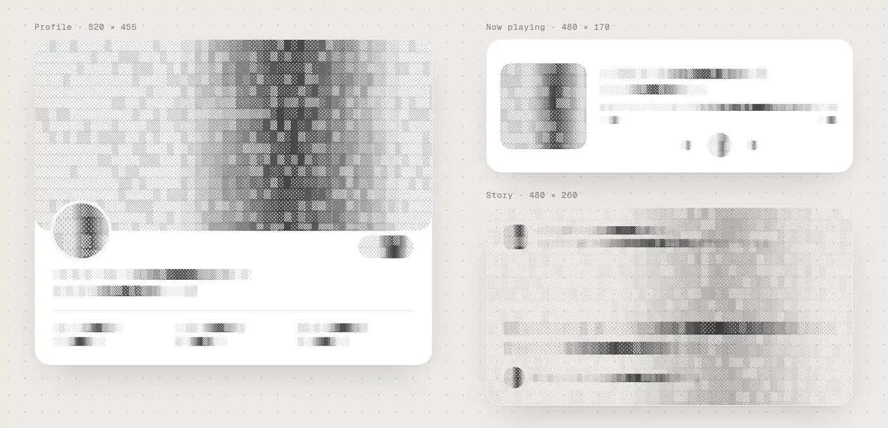

# ascii-reveal

<a href="https://quanhoangindex.github.io/ascii-reveal/">
  <picture>
    <source media="(prefers-color-scheme: dark)" srcset="assets/readme/ascii-reveal-demo-dark.webp">
    
  </picture>
</a>

<sub>Recorded from the real component: <code>&lt;AsciiSkeleton&gt;</code> while loading, then <code>&lt;AsciiReveal&gt;</code> decodes the data in. <b><a href="https://quanhoangindex.github.io/ascii-reveal/">Try the live demo →</a></b></sub>

```tsx
<AsciiReveal loading={!data}>
  {data ? <Profile data={data} /> : <AsciiSkeleton lines={3} />}
</AsciiReveal>
```

A loading effect for React. Text, images and whole cards decode into place through a character grid, in one wave across the page.

- **No layout shift.** Your content stays in the DOM in its real position. The scramble is drawn on a layer above it.
- **Works on anything.** Wrap a subtree and every text node, ``, `<canvas>` and `<video>` inside it takes part.
- **Real loading states.** Set `loading` and the content scrambles out, a glyph shimmer runs where the data will land, then the new data decodes in.
- **Accessible.** Screen readers read the real text the whole time. `prefers-reduced-motion` turns the reveal into a short fade.
- **Skeleton-fast.** `<AsciiSkeleton>` is plain HTML and CSS: it paints on the first frame, renders on the server and needs no JavaScript. Data becomes readable about 400 ms after it arrives.
- **Light.** One canvas per reveal, repainted at ~30 fps, one animation loop shared by every instance. Slow devices get a short fade instead. About 15 KB gzipped with all mascots and the skeleton, no dependencies.

## Install

From npm:

```bash
npm i ascii-reveal
```

Straight from GitHub (no npm publish needed):

```bash
npm i github:quanhoangindex/ascii-reveal
```

React 17 or newer is a peer dependency. The built files in `dist/` are committed, so the GitHub install works without a build step.

## Quick start

```tsx
import { AsciiReveal } from 'ascii-reveal';

export function Page() {
  return (
    <AsciiReveal preset="decode">
      <article className="card" data-ascii="surface">
        
        <h2>Hello world</h2>
        <button data-ascii="fade">Read more</button>
      </article>
    </AsciiReveal>
  );
}
```

The content reveals when the component mounts.

### Loading states

```tsx
const { data, isLoading } = useQuery(...);

<AsciiReveal loading={isLoading} selector="[data-value]" revealOnMount={false}>
  <dd data-value>{data?.latency ?? '—'}</dd>
</AsciiReveal>
```

When `loading` turns `true`, the matching content scrambles out and a shimmer runs in its place. When it turns `false`, the new content decodes in.

### Skeletons

Skeletons exist to paint instantly while data loads. `AsciiSkeleton` does exactly that, in ASCII. There are two ways to use it ([live demo](https://quanhoangindex.github.io/ascii-reveal/#skeleton)):

**1. Skeleton only.** A drop-in replacement for a gray skeleton. Content appears as normal when it arrives.

```tsx
import { AsciiSkeleton } from 'ascii-reveal';

{data ? <Profile data={data} /> : <AsciiSkeleton lines={3} />}
```

**2. Skeleton + reveal.** The skeleton paints first; when the data arrives, the real content decodes in (about 400 ms).

```tsx
import { AsciiReveal, AsciiSkeleton } from 'ascii-reveal';

<AsciiReveal loading={!data}>
  {data ? <Profile data={data} /> : <AsciiSkeleton lines={3} />}
</AsciiReveal>
```

The reveal never animates the skeleton itself. It leaves it alone while loading, and decodes the content that replaces it.

- It's static markup plus a CSS flicker, so it shows up in server-rendered HTML before any JavaScript runs, and reserves the space your content will take.
- Patterns are deterministic, so server and client output match (no hydration warnings).
- `lines` and `widths` shape a paragraph; `rows`, `width`, `height` and `circle` make a block for an image or avatar.
- A band of denser glyphs sweeps across a faint base pattern, like a classic shimmer. The pattern is plain HTML/CSS; the sweep is drawn on a small canvas once the component mounts. With reduced motion, the sweep stops.

Pick a style with `variant`:

| `variant` | Look |
| --- | --- |
| `dither` (default) | Shaded blocks `░▒▓█` that read as soft bars, with a darker dither band scanning across. |
| `scan` | Faint dots with a band of dense, scrambling glyphs. Matches the `decode` preset. |
| `braille` | Fine braille dot texture; the band fills the dots in. |
| `terminal` | Faint 0s and 1s, lit up in `--ascii-accent` as the band passes. |

```tsx
<AsciiSkeleton variant="braille" lines={3} />
<AsciiSkeleton variant="dither" rows={6} width={64} height={64} circle />
<AsciiSkeleton animate={false} lines={2} />   {/* still pattern: cheapest, for long lists */}
```

Without React: `el.innerHTML = asciiSkeletonHTML({ lines: 3 })`, then `animateSkeletons(el)`, both from `ascii-reveal/core`.

#### How much does it cost?

A skeleton only does its job if it shows up as fast as a gray box and never delays the data, so we measured it against one. Pre-rendered pages, no JavaScript needed to paint, Chromium on a machine without a GPU (so all drawing is done in software, the worst case), median of 7–11 runs:

| 12 cards, normal CPU | Gray skeleton | AsciiSkeleton | AsciiSkeleton `animate={false}` |
| --- | --- | --- | --- |
| First paint | 48 ms | 44 ms | 36 ms |
| Style + layout at load | 2 ms | 9 ms | 5 ms |
| Browser CPU while waiting | 15% | 21% | 0% |
| HTML (gzipped) | 0.5 KB | 3.2 KB | 3 KB |

How it stays cheap:

- The markup is a still glyph pattern (plain HTML + CSS), so it paints on the first frame before any JavaScript runs.
- The shimmer is drawn on one small canvas per skeleton at ~30 fps once the component mounts. Each row's glyphs are rendered once; a frame only copies the moving band. (Our first version animated a CSS mask instead: it looked the same but used 62% CPU, because the browser repainted every row every frame.)
- Off-screen skeletons, background tabs and reduced motion don't animate at all. For long lists, `animate={false}` skips the shimmer entirely.
- `AsciiSkeleton` never delays your data: content swaps in the moment it arrives. Only the optional `AsciiReveal` decode adds time (~350–400 ms after the data lands).
- With React 19, the skeleton's CSS is sent once per page. With React 18 it's repeated inline per skeleton; add `SKELETON_CSS` to your page once and use `asciiSkeletonHTML({ css: false })` if that matters to you.
- Without React: `el.innerHTML = asciiSkeletonHTML({ lines: 3 })`, then `animateSkeletons(el)` to start the shimmer.

Run it yourself: `node scripts/skeleton-bench/build.cjs && node scripts/skeleton-bench/bench.cjs`.

### Server rendering

Content that arrives in server-rendered HTML is never hidden on hydration: it's already readable, so hiding it to animate it would make the page slower. Set `revealOnHydrate` if you want the effect anyway. Client-side navigations and `loading` transitions animate as usual.

### Loading mascots

Swap the shimmer for an animated ASCII mascot while data loads. It dissolves as the new content decodes in.

```tsx
<AsciiReveal loading={isLoading} mascot="spider">  {/* spider | ghost | pumpkin | bat */}
  <Stats data={data} />
</AsciiReveal>

<AsciiReveal loading={isLoading} mascot="/logo.svg">…</AsciiReveal>      {/* your own SVG */}
```

Pass an SVG URL, SVG markup, or a draw function `(ctx, w, h, t, color) => void` for full control. Set `--ascii-mascot` to change the color of the line-art mascots.

### Replay from code

```tsx
const ref = useRef<AsciiRevealHandle>(null);

<AsciiReveal ref={ref}>…</AsciiReveal>

// replay one card from where it was clicked
ref.current?.reveal({ within: cardElement, origin: { x: e.clientX, y: e.clientY } });
ref.current?.hide();
```

## Props

| Prop | Type | Default | What it does |
| --- | --- | --- | --- |
| `preset` | `'decode' \| 'dither' \| 'terminal' \| 'blueprint' \| Preset` | `'decode'` | Glyph set, timing and image style. |
| `duration` | `'fast' \| 'cinematic'` | `'fast'` | `fast` makes data readable in ~400 ms. `cinematic` is the slower, showier wave for hero sections. |
| `speed` | `number` | `1` | Playback speed multiplier on top of `duration`. |
| `origin` | `'center' \| 'top-left' \| 'pointer' \| { x, y }` | `'center'` | Where the wave starts. `{ x, y }` is in viewport pixels. |
| `selector` | `string` | – | Only animate content inside elements matching this selector. |
| `revealOnMount` | `boolean` | `true` | Reveal when the component mounts. |
| `loading` | `boolean` | – | Scramble out and shimmer while `true`; decode in when it turns `false`. |
| `shimmer` | `boolean` | `true` | Show the glyph shimmer while loading. |
| `lazy` | `boolean` | `true` | Sections below the fold decode as they scroll into view instead of all at once. |
| `revealOnHydrate` | `boolean` | `false` | Also animate content that was server-rendered. |
| `fallback` | `boolean` | `true` | If frames take too long, finish the animation and use a short fade for the next 10 s. |
| `mascot` | `'spider' \| 'ghost' \| 'pumpkin' \| 'bat' \| string \| MascotDraw` | – | Animated ASCII mascot instead of the shimmer while loading. |
| `onRevealComplete` | `() => void` | – | Called when a reveal finishes. |
| `as` | `ElementType` | `'div'` | Element used for the wrapper. |

All other props pass through to the wrapper element.

## Marking elements

| Attribute | Effect |
| --- | --- |
| `data-ascii="surface"` | Cards and panels. A dot field and corner frame appear first, then the surface fades in. |
| `data-ascii="fade"` | Buttons, chips, badges. Fades in on the wave. |
| `data-ascii="media"` | Treat any element as media (rendered as a glyph texture). |
| `data-ascii="skip"` | Leave this subtree alone, for example a toolbar that must stay usable. |
| `data-ascii-digits` | Scramble only through digits (applied automatically to numeric text). |

## Theming

The effect reads these CSS custom properties from the wrapper:

```css
.my-app {
  --ascii-accent: #5b8cff;   /* cursor and blueprint glyphs */
  --ascii-skeleton: #888;    /* AsciiSkeleton glyph color (defaults to the text color) */
  --ascii-flash: #5b8cff;    /* optional: brief color as each character lands */
  --ascii-glyph: #888;       /* scramble glyph color (defaults to the text's own color at 50%) */
  --ascii-font: "Geist Mono", ui-monospace, monospace;
  --ascii-surface: #0b0b0d;  /* color behind transparent images, if detection is wrong */
}
```

## Without React

```ts
import { createAsciiReveal } from 'ascii-reveal/core';

const reveal = createAsciiReveal(document.querySelector('#app')!, { preset: 'dither' });
reveal.reveal();
// later
await reveal.hide();
reveal.shimmer(true);
```

## Presets

- **decode**: characters condense from light glyphs to dense ones, then lock to their real value.
- **dither**: block shading; images resolve in their own colors.
- **terminal**: a cursor leads each character, binary-style scramble.
- **blueprint**: line glyphs in the accent color.

Make your own by passing an object with the `Preset` shape (`ramp`, `scramble`, `mode`, `color`, `cells`, `tick`).

## Performance

Measured on the demo page with Playwright and Chromium, CPU throttled 4×, on a machine with no GPU (so every frame is drawn in software, which caps even the idle page at ~19 fps). Run it yourself with `scripts/bench.cjs` (instructions at the top of the file).

| | v0.2 | v0.3 |
| --- | --- | --- |
| Frame rate during Replay (page idle rate in brackets) | 8.4 fps (12.5) | 16.6 fps (19) |
| 95th percentile frame | 372 ms | 133 ms |
| Longest main-thread task | 297 ms | 174 ms |
| Data readable after it arrives | ~920 ms | ~350 ms |

Without throttling, v0.3 Replay runs at the page's idle frame rate and the longest task drops from 68 ms to under 20 ms. Note that v0.3's demo also replays only the card grid rather than the whole page.

What changed:

- **One canvas per reveal**, sized to what's animating, instead of one per image and card. Text that has landed is drawn once to a cached layer.
- **~30 fps repaint** for glyphs (they only change every 60–90 ms anyway); opacity still updates every frame.
- **Measuring is batched** and limited to the viewport plus a margin. Sections further down are hidden without measuring and decode when scrolled to.
- **Image grids are precomputed** once per cell size.
- **Watchdog**: if 8 frames blow past 45 ms, the reveal finishes immediately and the next reveals fade instead.

## Notes

- Cross-origin images without CORS headers can't be sampled; they reveal through a neutral glyph texture instead.
- Works with Next.js App Router: the React entry is marked `"use client"`.
- The reveal measures layout once when it starts. If the wrapper resizes mid-reveal, the reveal finishes instantly instead of drawing in the wrong place. If your fonts load late, start the reveal after `document.fonts.ready`.
- Icons drawn with `currentColor` stay visible while text is hidden. Emoji and combined characters are split correctly, and glyphs are clipped to scrolling containers.
- An `asciireveal` event (`detail: { active }`) bubbles from the wrapper when animation starts and stops, if you want to pause your own effects meanwhile.

## Develop

```bash
npm install
npm run build        # builds dist/
npm test             # browser smoke test (npx playwright install chromium first)
npm run demo         # runs the demo site (cd demo && npm install first)
```

See [CHANGELOG.md](CHANGELOG.md) for what changed between versions.

## License

MIT
